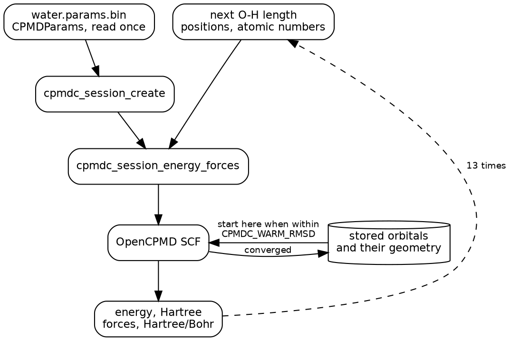
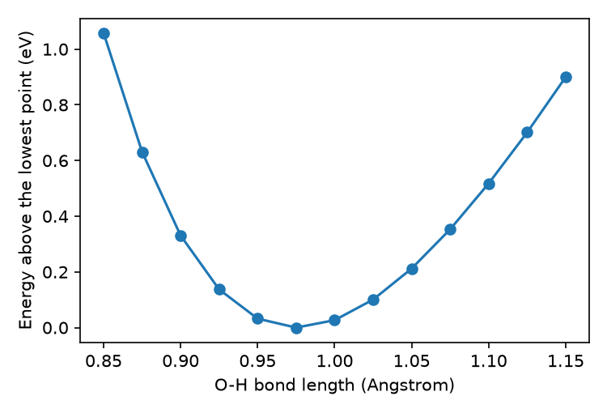
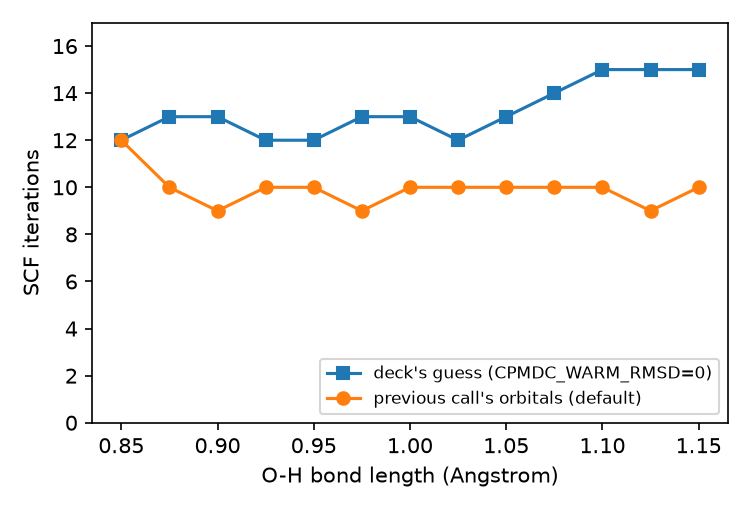

#+TITLE: Scan a bond through one session
#+OPTIONS: toc:nil todo:nil num:nil author:nil title:t

This tutorial stretches both O-H bonds of the water molecule from the [[file:first-energy.org][first tutorial]]
through 13 lengths, all in one ~cpmdc~ session, and plots the BLYP (Becke,
Lee, Yang, Parr) energy along that path.
It then runs the same scan with the stored orbitals switched off and counts
the self-consistent field (SCF) iterations each geometry takes.
You need what the first tutorial left behind: ~water.params.bin~, the OpenCPMD
build in ~$CPMDC/build-cpmd~, the ~Regtests~ pseudopotentials, and a shell
opened with ~pixi shell~.

#+CAPTION: One session, many geometries: the method is read once.

* Write the scan host
Save this program as ~scan_bond.c~ in ~cpmdc-tutorial~.
It creates one session and calls ~cpmdc_session_energy_forces()~ once per bond
length, from 0.850 to 1.150 Angstrom in steps of 0.025, keeping the 104.5
degree angle of the first tutorial's geometry:

#+begin_src c
#include <cpmdc.h>

#include <math.h>
#include <stdio.h>
#include <stdlib.h>

static unsigned char *slurp(const char *path, size_t *size) {
  FILE *fp = fopen(path, "rb");
  if (!fp)
    return NULL;
  fseek(fp, 0, SEEK_END);
  long len = ftell(fp);
  rewind(fp);
  unsigned char *buf = malloc((size_t)len);
  *size = fread(buf, 1, (size_t)len, fp);
  fclose(fp);
  return buf;
}

int main(int argc, char **argv) {
  if (argc != 2) {
    fprintf(stderr, "usage: %s params.bin\n", argv[0]);
    return 2;
  }
  size_t params_size = 0;
  unsigned char *params = slurp(argv[1], &params_size);
  if (!params)
    return 2;
  CPMDCSession *session = cpmdc_session_create(params, params_size);
  if (!session) {
    fprintf(stderr, "cpmdc_session_create failed: %s\n", cpmdc_last_error());
    return 1;
  }

  /* Unit vector from O to the first H, from the first tutorial's geometry. */
  const double len = sqrt(0.7572 * 0.7572 + 0.5865 * 0.5865);
  const double uy = 0.7572 / len, uz = -0.5865 / len;
  const int z[3] = {8, 1, 1};

  for (int i = 0; i <= 12; ++i) {
    double r = 0.85 + 0.025 * i;
    double pos[9] = {5.0, 5.0,          5.1173,           /* O */
                     5.0, 5.0 + r * uy, 5.1173 + r * uz,  /* H */
                     5.0, 5.0 - r * uy, 5.1173 + r * uz}; /* H */
    double f[9];
    CPMDCResult res = cpmdc_session_energy_forces(session, 3, pos, z, f);
    if (!res.ok) {
      fprintf(stderr, "r_oh=%.3f failed: %s\n", r, res.message);
      return 1;
    }
    /* Force on the first H along its bond; positive pushes it outward. */
    double f_bond = f[4] * uy + f[5] * uz;
    fprintf(stderr, "scan r_oh=%.3f energy_h=%.8f f_bond=%.6f\n", r,
            res.energy_h, f_bond);
  }

  cpmdc_session_destroy(session);
  cpmdc_finalize();
  free(params);
  return 0;
}
#+end_src

The positions are Angstrom, the energy comes back in Hartree, and the forces
in Hartree/Bohr.
CPMD (Car-Parrinello Molecular Dynamics) writes its report to standard output,
so the program writes its own lines to standard error.

* Run the scan
Build the program against the OpenCPMD library and run it with
~CPMDC_SCF_STEPS=1~, which makes ~cpmdc~ report how each SCF started and how
many iterations it took:

#+begin_src bash
mpicc -c scan_bond.c -I "$CPMDC/include"
mpif90 scan_bond.o -L "$CPMDC/build-cpmd" -lcpmdc \
  -Wl,-rpath,"$CPMDC/build-cpmd" -o scan_bond
export CPMDC_PSEUDO_DIR=$PWD/Regtests/tests/PP_LIBRARY
OMP_NUM_THREADS=1 CPMDC_SCF_STEPS=1 ./scan_bond water.params.bin \
  > cpmd.out 2> scan.log
grep '^scan' scan.log
#+end_src

#+begin_src text
scan r_oh=0.850 energy_h=-17.01738268 f_bond=0.193634
scan r_oh=0.875 energy_h=-17.03307972 f_bond=0.140074
...
scan r_oh=0.950 energy_h=-17.05508726 f_bond=0.025708
scan r_oh=0.975 energy_h=-17.05627134 f_bond=0.000233
scan r_oh=1.000 energy_h=-17.05528930 f_bond=-0.020279
...
scan r_oh=1.150 energy_h=-17.02320094 f_bond=-0.079972
#+end_src

Each line is one call on the same session; ~scan.csv~ beside the figures holds
all 13.
~grep cpmdc_ scan.log~ shows the SCF behind each call, in the same order.
The first two calls are:

#+begin_src text
cpmdc_warm_start -2 periodic=F
cpmdc_scf_steps 12
cpmdc_warm_start 0  2.0412414523193152E-002 donor_key=0 periodic=F
cpmdc_scf_steps 10
#+end_src

The first call has nothing stored (~cpmdc_warm_start -2~) and starts from the
deck's guess.
Every later call starts from the orbitals the previous call converged
(~cpmdc_warm_start 0~).
Each step moves the two hydrogens by 0.025 Angstrom, a root-mean-square
distance (RMSD) of 0.0204 Angstrom per atom, well inside the 0.15 Angstrom
default of ~CPMDC_WARM_RMSD~.

* Plot the energy
#+CAPTION: BLYP energy of water along the symmetric O-H stretch.

Of the 13 lengths, 0.975 Angstrom has the lowest energy, -17.05627134 Hartree,
and the 0.850 Angstrom end lies 1.058 eV above it.
The force along the bond, in Hartree/Bohr, is 0.000233 at 0.975 Angstrom and
-0.020279 at 1.000 Angstrom.
It changes sign between those two lengths, so the bond length for this method,
cutoff, and pair of pseudopotentials lies between them.
A finer step there, or a minimiser, narrows the interval.

* Turn the stored orbitals off
Set ~CPMDC_WARM_RMSD=0~ and run the scan again.
No stored geometry lies within zero distance, so every call starts from the
deck's guess, as a fresh process would:

#+begin_src bash
OMP_NUM_THREADS=1 CPMDC_SCF_STEPS=1 CPMDC_WARM_RMSD=0 ./scan_bond \
  water.params.bin > cpmd-cold.out 2> scan-cold.log
#+end_src

#+CAPTION: SCF iterations per geometry, from the guess or stored orbitals.

From the deck's guess, each geometry takes 12 to 15 iterations, 172 in all.
With the stored orbitals, the first call still takes 12 and the other twelve
take 9 or 10, 129 in all.
The two scans give the same energy at every length to within 6.0e-08 Hartree:
the stored orbitals change where the SCF starts, not where it ends.

* What you built
- a host that keeps one session and passes only positions to each call;
- an energy curve and a force sign change that bracket the bond length;
- a measured count of the SCF iterations the stored orbitals save.

~docs/figures/bond-scan/run_scan.sh~ in the repository reruns both scans from
this page's program, and ~render.sh~ redraws the figures.
[[file:../explanation/wavefunction-state.org][Wavefunction state]] explains
how ~cpmdc~ picks the stored orbitals, and the [[file:eon-rgpot.org][eOn tutorial]]
drives the same kind of loop from a minimiser.
